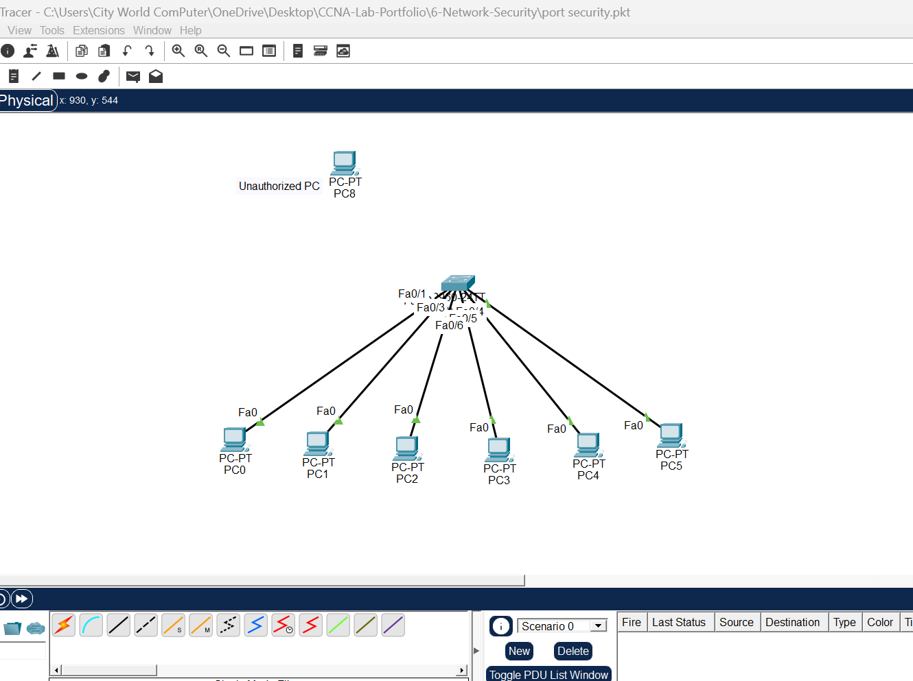
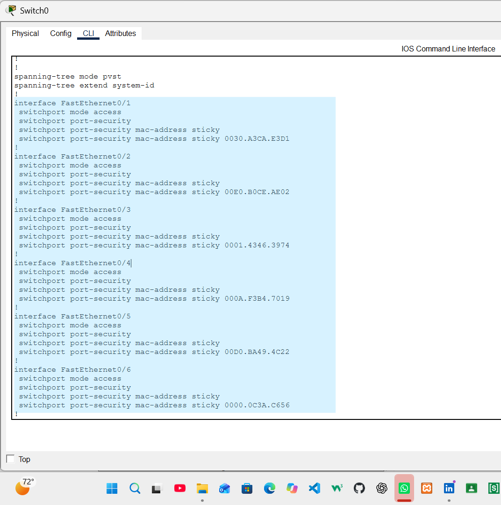
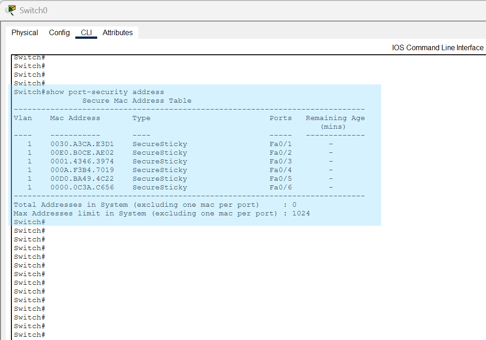
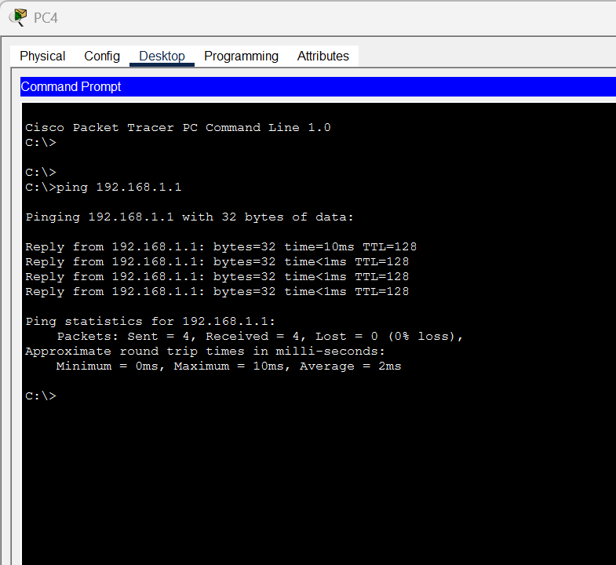
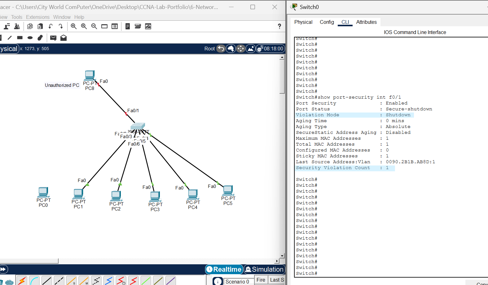
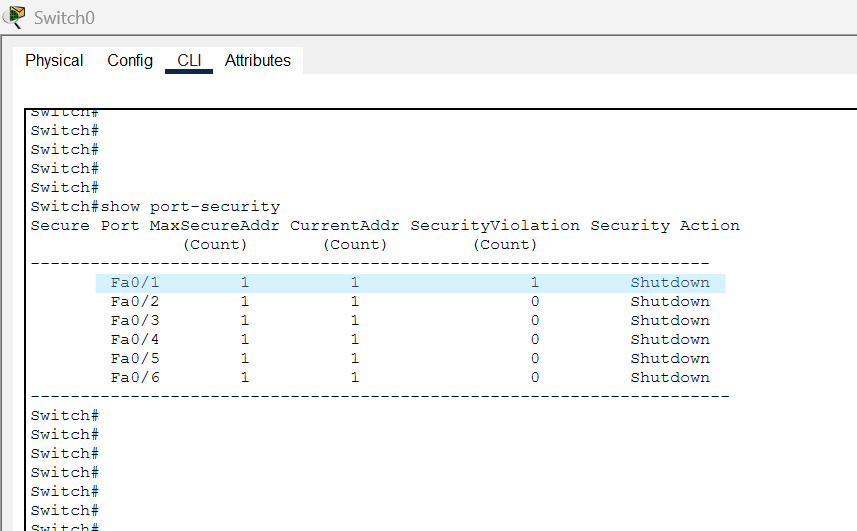

# 🔐 Switch Port Security Lab | Cisco Packet Tracer

<p align="center">
  <b>CCNA Lab Portfolio</b><br>
  Practical Network Security Configuration & Testing
</p>

---

## 📌 Project Overview

This lab demonstrates the configuration and implementation of **Switch Port Security** using Cisco Packet Tracer.

Port Security is a Layer 2 security feature that helps protect a switch from unauthorized device connections by controlling which MAC addresses are allowed on a switch port.

In this lab, I configured Port Security on six switch access ports using Sticky MAC Address learning and tested network connectivity and security violation behavior.

## 🎯 Lab Objectives

- Understand Cisco Switch Port Security.
- Configure Port Security on multiple switch ports.
- Implement Sticky MAC Address learning.
- Set the maximum number of allowed MAC addresses.
- Configure the Security Violation mode.
- Verify learned secure MAC addresses.
- Test authorized and unauthorized device connections.
- Observe Port Security violation behavior.

## 🖥️ Network Topology

| Device | Quantity |
|---|---:|
| Cisco 2960 Switch | 1 |
| PCs | 6 |
| Network Connections | 6 |

**Topology:** One switch connected to six PCs in a star topology.

## 🌐 IP Addressing Scheme

| Device | IP Address | Subnet Mask |
|---|---|---|
| PC0 | 192.168.1.1 | 255.255.255.0 |
| PC1 | 192.168.1.2 | 255.255.255.0 |
| PC2 | 192.168.1.3 | 255.255.255.0 |
| PC3 | 192.168.1.4 | 255.255.255.0 |
| PC4 | 192.168.1.5 | 255.255.255.0 |
| PC5 | 192.168.1.6 | 255.255.255.0 |

## ⚙️ Configuration

Port Security was configured on FastEthernet ports Fa0/1 through Fa0/6 using the following commands:

```bash
enable
configure terminal

interface range fa0/1-6

switchport mode access
switchport port-security
switchport port-security maximum 1
switchport port-security mac-address sticky
switchport port-security violation shutdown

end
```

### 🔍 Configuration Explanation

| Command | Purpose |
|---|---|
| `interface range fa0/1-6` | Selects six switch ports simultaneously |
| `switchport mode access` | Configures ports as access ports |
| `switchport port-security` | Enables Port Security |
| `switchport port-security maximum 1` | Allows one secure MAC address per port |
| `switchport port-security mac-address sticky` | Dynamically learns and saves MAC addresses |
| `switchport port-security violation shutdown` | Disables the port when a security violation occurs |

## 🧪 Testing & Verification

The following practical tests were performed:

**1. Network Topology**

Created a network consisting of one Cisco 2960 switch and six PCs.

**2. Port Security Configuration**

Applied Port Security settings to all six access ports.

**3. Secure MAC Address Verification**

Used the following command to display learned secure MAC addresses:

```bash
show port-security address
```

**4. Connectivity Test**

Performed a ping test from PC4 to PC1 to verify communication between authorized devices.

**5. Unauthorized Device Test**

Disconnected the original authorized device from Fa0/1 and connected a different PC.

When the new device attempted to communicate, the switch detected a MAC address violation and placed the port into a security shutdown state.

**6. Port Security Verification**

Used the following commands to inspect Port Security status:

```bash
show port-security
show port-security interface fa0/1
```

## 📸 Lab Screenshots

### 01. Network Topology


### 02. Port Security Configuration


### 03. Secure MAC Address Table


### 04. Network Connectivity Test


### 05. Unauthorized Device & Security Violation


### 06. Port Security Verification


## 📚 Key Learnings

Through this practical lab, I learned:

- How to enable and configure Cisco Switch Port Security.
- How Sticky MAC learning works.
- How to restrict switch ports to one MAC address.
- How to identify unauthorized device connections.
- How Port Security violations affect switch port operation.
- How to verify Port Security using Cisco IOS commands.

## 🛠️ Tools & Technologies

- Cisco Packet Tracer
- Cisco Catalyst 2960 Switch
- Cisco IOS CLI
- Ethernet Networking
- Layer 2 Network Security

---

**Project:** Switch Port Security Configuration & Testing  
**Category:** CCNA | Basic Networking | Network Security  
**Status:** Completed ✅

*Part of my continuous CCNA learning and hands-on networking lab journey.*